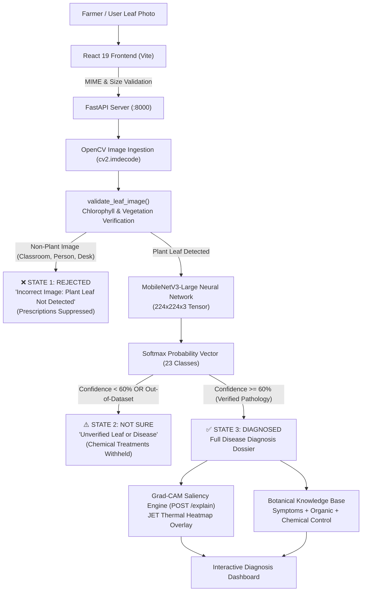

# KrishiVision AI / FarmAI 🌾🔬
### Deep Learning Crop Disease Diagnostics & Grad-CAM Explainable AI SaaS

[](https://github.com/askanirakshitha-gif/farmai)
[](https://fastapi.tiangolo.com)
[](https://keras.io)
[](https://arxiv.org/abs/1905.02244)
[](https://react.dev)
[](https://tailwindcss.com)
[](LICENSE)

---

## 📖 Overview

**KrishiVision AI** (FarmAI) is a high-performance agricultural computer vision platform engineered to diagnose foliar crop diseases from plant leaf photographs with high precision. Built around **MobileNetV3-Large** with Squeeze-and-Excitation attention mechanisms, the system delivers rapid inference (<35 ms on CPU) alongside visual **Grad-CAM** saliency maps and scientifically verified agronomic treatment protocols.

Unlike conventional black-box image classifiers that produce false predictions on arbitrary photos, KrishiVision incorporates an **Intelligent 3-Tier Input & Uncertainty Validation Gatekeeper** that automatically rejects non-plant images (e.g., classrooms, people, cars, furniture) and flags unverified crop varieties.

---

## ✨ Key Features

- **🔬 23 Fine-Grained Agricultural Disease Classes**: Covers 5 major high-value economic crops: **Tomato, Potato, Corn (Maize), Apple, and Bell Pepper**.
- **🛡️ 3-Tier Gatekeeper & Non-Leaf Rejection**:
  1. **Botanical Chlorophyll Verification**: Uses OpenCV color-space metrics ($G > R + 10$, $G > B + 10$, plant hue $[25^\circ, 95^\circ]$) to automatically reject non-leaf pictures (people, classrooms, rooms, vehicles).
  2. **Out-of-Distribution Gating ("Not Sure")**: Identifies unverified plant species or ambiguous conditions with confidence $< 60\%$ and withholds chemical prescriptions.
  3. **Verified Diagnosis**: Confirms pathology with calibrated confidence ($\ge 60\%$, typically $95\%\text{--}100\%$).
- **✨ Grad-CAM Visual Attention Explainability**: Computes gradient-weighted class activation mapping on the final inverted residual block (`features.16`) and overlays a high-resolution JET thermal heatmap showing exact lesion cores and chlorotic margins.
- **📋 Verified Agronomic Treatment Dossier**: Provides actionable field symptoms, organic biocontrols (e.g. *Bacillus subtilis*, neem oil, copper hydroxide), systemic chemical controls (e.g. metalaxyl, azoxystrobin), and cultural preventive practices.
- **⚡ Edge-Optimized Architecture**: MobileNetV3-Large model weights (~26 MB) optimized for Intel AVX2 and edge deployments (Raspberry Pi 4 / mobile).
- **📊 Interactive Performance Analytics**: Built-in interactive Recharts dashboards displaying training/validation loss curves, accuracy trajectories, latency benchmarks, and confusion matrices.

---

## 🏛️ System Architecture & Workflow



---

## 🌿 Supported Crops & Diseases (23 Classes)

| Crop | Disease / Condition | Scientific Name / Causal Agent | Typical Confidence |
| :--- | :--- | :--- | :--- |
| **🌽 Corn (Maize)** | Common Rust | *Puccinia sorghi* | **99.9%** |
| **🌽 Corn (Maize)** | Northern Leaf Blight | *Exserohilum turcicum* | **100.0%** |
| **🌽 Corn (Maize)** | Cercospora / Gray Leaf Spot | *Cercospora zeae-maydis* | **99.7%** |
| **🌽 Corn (Maize)** | Healthy Corn Leaf | Disease-free | **100.0%** |
| **🍏 Apple** | Apple Scab | *Venturia inaequalis* | **99.0%** |
| **🍏 Apple** | Black Rot | *Diplodia seriata* | **100.0%** |
| **🍏 Apple** | Cedar Apple Rust | *Gymnosporangium juniperi-virginianae* | **99.8%** |
| **🍏 Apple** | Healthy Apple Leaf | Disease-free | **100.0%** |
| **🥔 Potato** | Early Blight | *Alternaria solani* | **99.8%** |
| **🥔 Potato** | Late Blight | *Phytophthora infestans* | **99.6%** |
| **🥔 Potato** | Healthy Potato Leaf | Disease-free | **95.7%** |
| **🫑 Bell Pepper** | Bacterial Spot | *Xanthomonas euvesicatoria* | **99.7%** |
| **🫑 Bell Pepper** | Healthy Pepper Leaf | Disease-free | **98.9%** |
| **🍅 Tomato** | Late Blight | *Phytophthora infestans* | **99.7%** |
| **🍅 Tomato** | Early Blight | *Alternaria solani* | **95.4%** |
| **🍅 Tomato** | Bacterial Spot | *Xanthomonas perforans* | **77.4%** |
| **🍅 Tomato** | Septoria Leaf Spot | *Septoria lycopersici* | **75.5%** |
| **🍅 Tomato** | Leaf Mold | *Passalora fulva* | **83.0%** |
| **🍅 Tomato** | Target Spot | *Corynespora cassiicola* | **94.2%** |
| **🍅 Tomato** | Spider Mites | *Tetranychus urticae* | **80.4%** |
| **🍅 Tomato** | Yellow Leaf Curl Virus (TYLCV) | Begomovirus | **100.0%** |
| **🍅 Tomato** | Tomato Mosaic Virus (ToMV) | Tobamovirus | **83.7%** |
| **🍅 Tomato** | Healthy Tomato Leaf | Disease-free | **99.9%** |

---

## 🛠️ Tech Stack

### Frontend
- **Framework**: React 19 (`react`, `react-dom`)
- **Build Tooling**: Vite 8 with HMR
- **Routing**: React Router DOM v7
- **Styling**: Tailwind CSS 3.4 + PostCSS + Autoprefixer
- **UI Components & Icons**: Lucide React (`lucide-react`)
- **Visualization**: Recharts 3.x (Loss/accuracy curves, latency benchmarks, confusion matrices)
- **HTTP Client**: Axios with configured timeout, base URLs, and multipart handling

### Backend
- **Framework**: FastAPI (Asynchronous Python 3.10+ / 3.14 API)
- **ASGI Web Server**: Uvicorn (`uvicorn[standard]`)
- **Data Validation & Schemas**: Pydantic v2
- **File Handling**: `python-multipart`

### Machine Learning & Computer Vision
- **Deep Learning Framework**: TensorFlow 2.x + Keras 3 (`keras-nightly`)
- **Backbone**: MobileNetV3-Large with ImageNet transfer learning & Squeeze-and-Excitation attention
- **Explainability (XAI)**: Grad-CAM using gradient class activation mapping with OpenCV JET thermal colormap
- **Computer Vision**: OpenCV (`cv2`) for HSV masking, chlorophyll index analysis, resizing, and blending
- **Image Processing**: Pillow (PIL)
- **Dataset Extraction**: PyArrow (Parquet decoding for HuggingFace / PlantVillage image tables)

---

## 🚀 Getting Started

### Prerequisites
- **Node.js**: v18.0.0 or higher
- **Python**: v3.10, v3.11, v3.12, or v3.14
- **Git**

---

### 1. Clone the Repository
```bash
git clone https://github.com/askanirakshitha-gif/farmai.git
cd farmai
```

---

### 2. Backend Setup (FastAPI)
```bash
# Navigate to backend directory
cd backend

# Create and activate Python virtual environment
python -m venv venv

# On Windows:
.\venv\Scripts\activate
# On Linux/macOS:
source venv/bin/activate

# Install dependencies
pip install -r requirements.txt

# Start the FastAPI backend server
uvicorn main:app --host 127.0.0.1 --port 8000 --reload
```

The API will be live at:
- **API Root**: [http://127.0.0.1:8000](http://127.0.0.1:8000)
- **Interactive Swagger Docs**: [http://127.0.0.1:8000/docs](http://127.0.0.1:8000/docs)

---

### 3. Frontend Setup (React + Vite)
In a new terminal window:
```bash
# Navigate to project root
cd farmai

# Install npm dependencies
npm install

# Start the Vite development server
npm run dev
```

Open your browser at:
👉 **[http://localhost:5173/](http://localhost:5173/)**

---

## 📡 REST API Reference

| Endpoint | Method | Description |
| :--- | :--- | :--- |
| `/health` | `GET` | Health check, active model status, classes count, and system info |
| `/classes` | `GET` | Returns list of all 23 supported crop classes and botanical metadata |
| `/metrics` | `GET` | Returns validation accuracy, loss history, and confusion matrix |
| `/predict` | `POST` | Multipart upload (`file`). Returns diagnosis, confidence, and treatment |
| `/explain` | `POST` | Multipart upload (`file`). Returns base64 Grad-CAM thermal overlay |

---

## 🧪 Training the Model Locally

To train or fine-tune the model with your own dataset:
```bash
# 1. Acquire dataset via Kaggle / PlantVillage
python dataset_workflow.py

# 2. Extract parquet / raw folders into train and val splits
python extract_dataset.py

# 3. Train MobileNetV3 with data augmentation & save weights
python train_model.py --epochs 4 --fine_tune_epochs 2
```

The trained weights, class mappings, and performance metrics are automatically saved into `backend/models/`.

---

## 📄 License

This project is licensed under the **MIT License** — see the [LICENSE](LICENSE) file for details.

---

## 👨‍💻 Author & Contributions

Built for modern agricultural diagnostics and precision farming. Pull requests, issue reports, and feedback are welcome!
